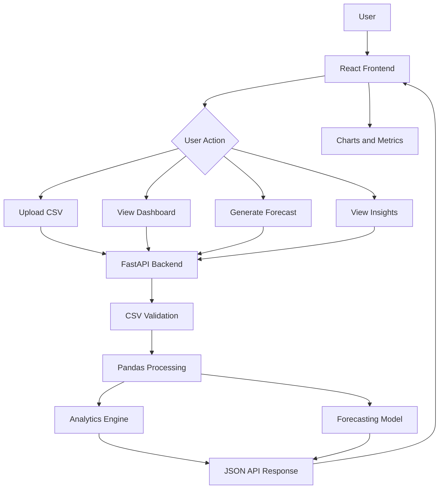
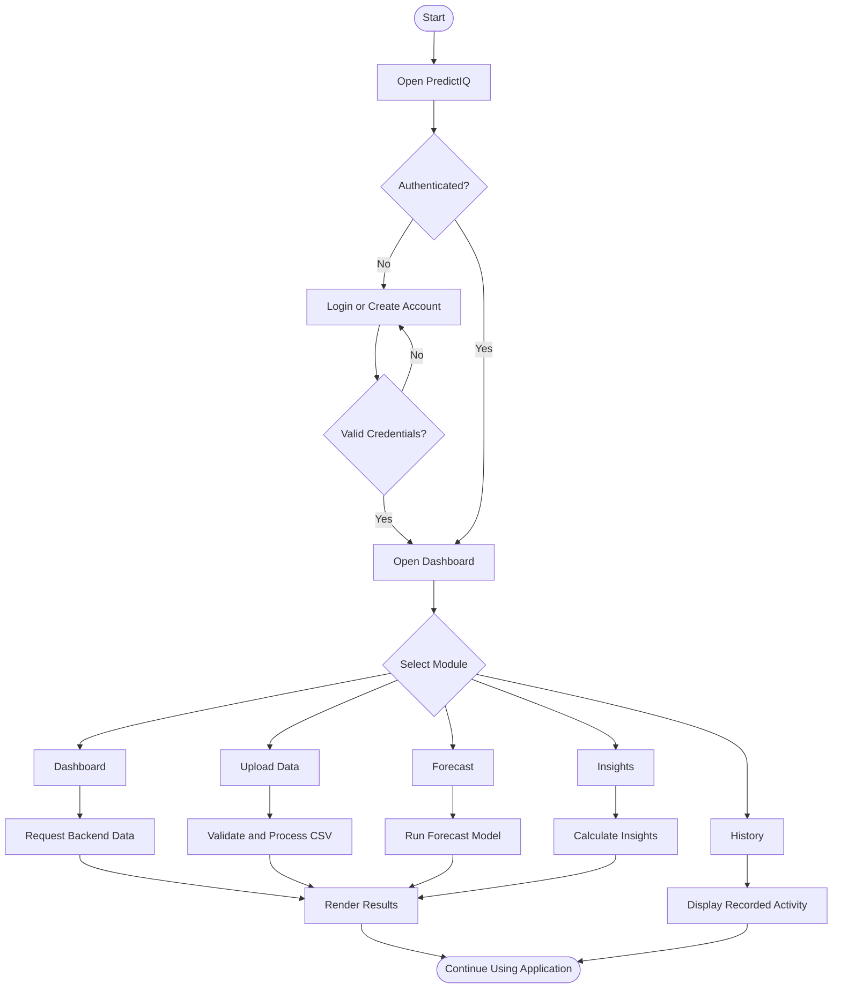
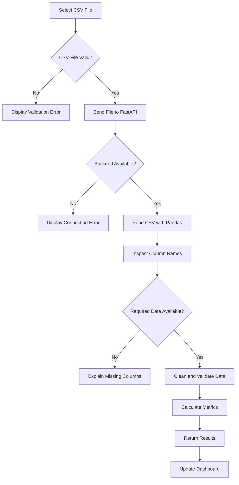
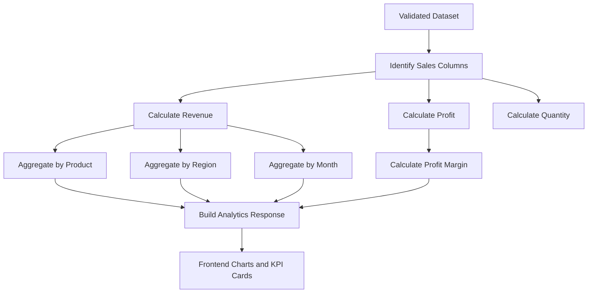
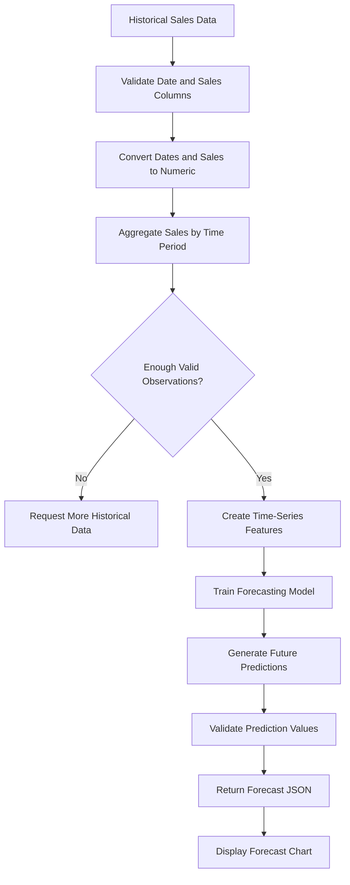
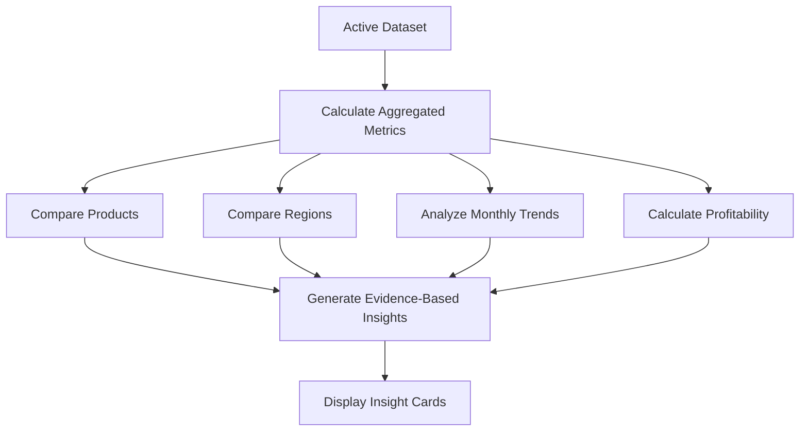
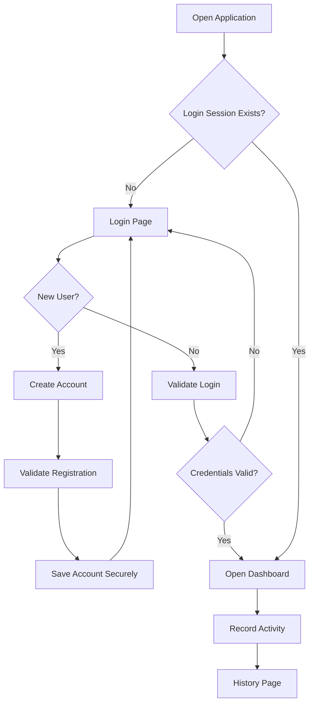

# PredictIQ 📊
> **Sales Forecasting & Business Intelligence Platform**

PredictIQ is a full-stack analytics platform that transforms sales datasets into
meaningful business insights, interactive visualizations, and machine-learning-based
sales forecasts.

It enables users to upload sales transaction CSV files, analyze revenue and profit,
compare products and regions, explore historical trends, and generate predictions
to support data-driven business decisions.


---

## 📖 Table of Contents

1. Overview
2. Key Features
3. Technology Stack
4. System Architecture
5. Application Flowchart
6. CSV Upload Flow
7. Analytics Flow
8. Forecasting Flow
9. Insights Generation
10. Authentication Flow
11. Project Structure
12. Dataset Requirements
13. Installation
14. Backend Setup
15. Frontend Setup
16. API Endpoints
17. Forecasting Methodology
18. Dashboard Modules
19. Error Handling
20. Testing
21. Security Considerations
22. Troubleshooting
23. Future Enhancements
24. Author
25. License

---

## 🌟 1. Overview

PredictIQ provides an integrated environment for sales analytics and forecasting.

### Problem Statement

Businesses generate large amounts of sales data but often struggle to identify
trends, evaluate product performance, understand regional differences, and
estimate future sales.

### Solution

PredictIQ processes uploaded datasets and provides:

- Sales and revenue summaries.
- Product and regional performance comparisons.
- Monthly and historical sales trends.
- Profit and margin analysis.
- Forecasts based on historical data.
- Interactive charts and business insights.
- A history page for recorded application activity.

### Target Users

- Business analysts.
- Sales managers.
- Students and researchers.
- Small and medium-sized businesses.
- Data science and machine learning learners.

---

## ✨ 2. Key Features

### 📊 Interactive Dashboard

- Total revenue and sales metrics.
- Profit and profit-margin summaries.
- Product and regional performance.
- Monthly revenue trends.
- Recent transaction information.
- Dataset-driven visualizations.

### 📂 CSV Dataset Upload

- Upload sales transaction datasets.
- Validate file type and required columns.
- Parse and preprocess uploaded data.
- Handle missing or invalid values appropriately.
- Display useful validation errors.
- Use uploaded data for subsequent analysis.

### 📈 Sales Forecasting

- Analyze historical sales patterns.
- Aggregate sales by date or month.
- Train a forecasting model when sufficient data exists.
- Generate future sales estimates.
- Visualize historical and predicted values.
- Display model limitations where appropriate.

### 💡 Business Insights

- Identify the highest-revenue product category.
- Compare regional sales performance.
- Find top-performing products.
- Calculate overall profit margins.
- Highlight changes in historical performance.
- Generate insights from the active dataset.

### 🔐 Authentication

- Login page.
- Create-account page.
- Email and password validation.
- Password confirmation during registration.
- Sign-out functionality.
- Password recovery support when configured.

### 🕘 Activity History

- Record relevant application activities.
- Display recent activity.
- Show timestamps and descriptions.
- Allow users to clear their history.

---

## 🛠 3. Technology Stack

| Layer | Technology |
|---|---|
| Frontend | React |
| Language | TypeScript |
| Build tool | Vite |
| Styling | CSS |
| Charts | Existing charting library |
| Icons | Lucide React |
| Backend | FastAPI |
| API Server | Uvicorn |
| Data Processing | Pandas, NumPy |
| Machine Learning | Scikit-learn |
| Database | SQLAlchemy with configured database |
| Data Format | CSV |
| API Testing | FastAPI Swagger UI |
| Version Control | Git and GitHub |

---

## 🏗 4. System Architecture



### Architecture Components

**Frontend**
- Collects user input.
- Uploads datasets.
- Requests analytics and forecasts.
- Displays charts, metrics, and errors.

**Backend**
- Exposes REST API endpoints.
- Validates and processes data.
- Calculates business metrics.
- Generates forecasts.
- Returns structured JSON responses.

**Data Processing**
- Reads CSV files.
- Identifies relevant columns.
- Converts dates and numeric values.
- Handles missing values.
- Aggregates transactions for analysis.

**Machine Learning**
- Uses historical sales values.
- Trains an appropriate model.
- Predicts future sales when enough valid data exists.
- Returns predictions for visualization.

---

## 🔄 5. Application Flowchart



---

## 📂 6. CSV Upload Flow



### Upload Validation

The backend should:

1. Accept CSV files only.
2. Check that the file is readable.
3. Validate the columns required for the selected operation.
4. Convert date columns to valid dates.
5. Convert revenue, quantity, and profit fields to numeric values.
6. Handle missing values without silently inventing sales.
7. Return a clear error when the dataset cannot support an operation.
8. Ensure analytics use the dataset uploaded by the user.

---

## 📊 7. Analytics Flow



### Core Metrics

| Metric | Description |
|---|---|
| Total Revenue | Sum of valid sales revenue |
| Total Profit | Sum of profit values when available |
| Total Orders | Count of transactions or unique order IDs |
| Units Sold | Sum of valid quantity values |
| Average Order Value | Revenue divided by order count |
| Profit Margin | Profit divided by revenue, multiplied by 100 |
| Top Product | Product with the highest aggregated revenue |
| Top Region | Region with the highest aggregated revenue |

Metrics should be calculated from the actual uploaded dataset, not fixed demonstration values.

---

## 🔮 8. Forecasting Flow



### Forecasting Requirements

- Use the actual uploaded dataset.
- Sort historical observations chronologically.
- Aggregate duplicate dates when necessary.
- Avoid using future information to predict the past.
- Separate training and validation periods when evaluating a model.
- Report an appropriate evaluation metric when possible.
- Handle insufficient or irregular data gracefully.
- Clearly label predictions as estimates, not guaranteed outcomes.
- Do not substitute hardcoded forecast values when model predictions fail.

---

## 💡 9. Business Insights Flow



Each insight should contain:

- A meaningful title.
- A finding derived from the dataset.
- The relevant metric or comparison.
- A clear business interpretation.

If the dataset changes, the displayed insights must update accordingly.

---

## 🔐 10. Authentication Flow



**Security note:** Browser `localStorage` authentication is suitable only for a demonstration. A production deployment should use backend authentication, secure password hashing, protected sessions, and authorization checks.

---

## 📁 11. Project Structure

```text
PredictIQ/
├── frontend/
│   ├── src/
│   │   ├── components/
│   │   │   ├── Sidebar.tsx
│   │   │   ├── MetricCard.tsx
│   │   │   ├── RevenueChart.tsx
│   │   │   ├── SalesTable.tsx
│   │   │   └── ForecastChart.tsx
│   │   ├── pages/
│   │   │   ├── Dashboard.tsx
│   │   │   ├── Upload.tsx
│   │   │   ├── Forecast.tsx
│   │   │   ├── Insights.tsx
│   │   │   ├── Login.tsx
│   │   │   ├── CreateAccount.tsx
│   │   │   └── History.tsx
│   │   ├── styles/
│   │   │   └── Login.css
│   │   └── App.tsx
│   └── package.json
├── backend/
│   ├── main.py
│   ├── database.py
│   ├── models.py
│   ├── routes/
│   │   ├── analytics.py
│   │   ├── upload.py
│   │   └── forecast.py
│   ├── ml/
│   │   ├── preprocessing.py
│   │   └── forecasting.py
│   └── requirements.txt
├── data/
│   └── sales.csv
├── README.md
└── .gitignore
```

This structure describes the intended layout. Keep only files that actually exist in your repository.

---

## 📄 12. Dataset Requirements

A basic dataset can contain these columns:

| Column | Purpose |
|---|---|
| Order_Date | Date of transaction |
| Order_ID | Transaction identifier |
| Product | Product name |
| Category | Product category |
| Region | Sales region |
| Quantity | Units sold |
| Unit_Price | Price per unit |
| Revenue | Total sales value |
| Profit | Profit value |

The exact column names depend on the dataset and backend implementation. If revenue is not provided, it can be derived from quantity and unit price when both are valid.

### Example CSV

```csv
Order_Date,Order_ID,Product,Category,Region,Quantity,Unit_Price,Revenue,Profit
2026-01-05,ORD001,Laptop,Electronics,South,2,55000,110000,12000
2026-01-08,ORD002,Chair,Furniture,North,4,4500,18000,3600
2026-01-12,ORD003,Phone,Electronics,West,3,22000,66000,9000
2026-02-02,ORD004,Desk,Furniture,East,2,8000,16000,2800
2026-02-15,ORD005,Headphones,Accessories,South,5,1800,9000,2250
```

This small example is for validation only. Meaningful forecasting generally requires more historical observations.

---

## 🚀 13. Installation

### Prerequisites

- Python 3.10 or newer.
- Node.js and npm.
- Git.
- Visual Studio Code.
- A modern web browser.

### Clone the Repository

```bash
git clone <your-github-repository-url>
cd PredictIQ
```

If the project is already on your computer, open its existing folder instead.

---

## ⚙️ 14. Backend Setup

Open PowerShell:

```powershell
cd D:\PredictIQ\backend
```

Create a virtual environment if one does not exist:

```powershell
python -m venv venv
```

Activate it:

```powershell
.\venv\Scripts\Activate.ps1
```

Install dependencies:

```powershell
python -m pip install --upgrade pip
python -m pip install fastapi uvicorn pandas numpy scikit-learn sqlalchemy python-multipart
```

Start the API server:

```powershell
python -m uvicorn main:app --reload
```

Expected local address:

```text
http://127.0.0.1:8000
```

API documentation:

```text
http://127.0.0.1:8000/docs
```

Health endpoint, if implemented:

```text
http://127.0.0.1:8000/health
```

---

## 🖥 15. Frontend Setup

Open a second terminal:

```powershell
cd D:\PredictIQ\frontend
```

Install dependencies:

```powershell
npm install
```

Start the development server:

```powershell
npm run dev
```

Open the local URL shown by Vite, commonly:

```text
http://localhost:5173
```

If port 5173 is occupied, Vite may select another port, such as 5174. Use the URL printed in the terminal.

Keep the backend and frontend running in separate terminals.

---

## 🔌 16. API Endpoints

The actual endpoints depend on the registered FastAPI routers.

| Endpoint | Purpose |
|---|---|
| `GET /` | API status |
| `GET /health` | Backend health check, if configured |
| `GET /docs` | Interactive API documentation |
| `GET /analytics/summary` | Summary metrics, if implemented |
| `GET /analytics/dataset` | Dataset information, if implemented |
| `GET /analytics/category` | Category analysis, if implemented |
| `GET /analytics/region` | Regional analysis, if implemented |
| `GET /analytics/products` | Product analysis, if implemented |
| `GET /analytics/monthly` | Monthly sales aggregation, if implemented |
| `GET /analytics/profit` | Profit analysis, if implemented |

Upload and forecasting endpoints must be verified in `/docs` before the frontend uses them.

### Example API Response

```json
{
  "total_revenue": 219000,
  "total_profit": 29650,
  "total_orders": 5,
  "status": "success"
}
```

This is an illustrative response format, not a claim about the exact live API response.

---

## 🧠 17. Forecasting Methodology

A forecasting pipeline typically consists of:

1. Dataset validation.
2. Date and numeric conversion.
3. Time-based aggregation.
4. Missing-value handling.
5. Feature preparation.
6. Chronological training and validation.
7. Model fitting.
8. Future prediction.
9. Evaluation and result visualization.

Potential models include:

- Linear Regression with time-based features.
- Random Forest Regressor.
- Gradient Boosting Regressor.
- Time-series models selected according to dataset characteristics.

Model selection should be based on validation performance and data suitability, rather than assuming one model works best for every dataset.

---

## 📱 18. Dashboard Modules

### Dashboard
Displays summary KPIs, revenue trends, and sales activity.

### Upload Data
Accepts a CSV file and validates the dataset before analysis.

### Forecast
Displays historical values alongside future sales estimates.

### Insights
Shows evidence-based observations about products, regions, and profitability.

### History
Displays recorded activities with timestamps.

### Login and Create Account
Provide the application's demonstration authentication interface.

---

## 🧪 19. Testing Checklist

- [ ] Backend starts without import errors.
- [ ] Frontend loads without a blank screen.
- [ ] API documentation opens successfully.
- [ ] Frontend can reach the backend.
- [ ] Valid CSV uploads are accepted.
- [ ] Invalid files display clear errors.
- [ ] Uploaded data is used for analysis.
- [ ] KPI values match independently calculated values.
- [ ] Product and regional charts reflect the dataset.
- [ ] Forecasts use historical sales observations.
- [ ] Insufficient data produces an informative message.
- [ ] Insights update when the dataset changes.
- [ ] Account creation validates input.
- [ ] Login rejects invalid credentials.
- [ ] History displays recorded activity.
- [ ] Sign-out returns the user to the login page.
- [ ] Light and dark modes remain readable.

---

## 🛡 20. Error Handling

PredictIQ should provide understandable messages for:

- Backend unavailable.
- Incorrect API URL.
- Invalid CSV format.
- Missing required columns.
- Empty datasets.
- Invalid dates or numeric values.
- Insufficient historical data.
- Failed forecasting operations.
- Unexpected server errors.

Frontend error messages should reflect the real API result rather than showing success when a request fails.

---

## 🔧 21. Troubleshooting

### Uvicorn Is Not Recognized

Run:

```powershell
python -m uvicorn main:app --reload
```

Ensure the backend virtual environment is activated and Uvicorn is installed.

### Backend Returns 404

Check the exact URL and HTTP method in `/docs`. A route must be registered in FastAPI before the frontend can call it.

### Frontend Cannot Reach Backend

Check that the API is running at the configured URL and that CORS permits the frontend origin.

### Upload Fails

Verify the multipart form field name, upload endpoint, CSV parsing logic, and required columns.

### White Page After Login

Check the browser console and terminal for React errors, incorrect imports, and invalid component rendering.

### Forecast Is Empty

Check the date column, sales values, available history, and model response.

---

## 🔒 22. Security Considerations

- Never commit API keys or database credentials.
- Use environment variables for secrets.
- Validate uploaded files on the server.
- Restrict upload size and handle malformed files.
- Hash passwords using a secure password-hashing algorithm.
- Use secure session management for production.
- Protect user-specific data with authorization.
- Avoid exposing sensitive exception details to users.
- Treat model predictions as estimates rather than guarantees.

---

## 🚧 23. Future Enhancements

- Improved time-series forecasting.
- Forecast accuracy and model comparison.
- More flexible dataset column mapping.
- Automated data-quality reports.
- Downloadable analytics reports.
- Exportable forecast results.
- Persistent user accounts and activity history.
- Database-backed upload history.
- More advanced business recommendations.
- Cloud deployment with secure configuration.
- Automated backend and frontend tests.
- Responsive mobile dashboard.

---

## 👩‍💻 24. Author

**Pravallika Emandi**

PredictIQ — Sales Forecasting & Business Intelligence

Built to demonstrate skills in Python, React, FastAPI, data analytics,
machine learning, data visualization, and full-stack application development.

GitHub: [Add your repository URL here]

---

## 📄 25. License

This project is intended for educational and portfolio use.

If you choose the MIT License, add a `LICENSE` file containing the
official MIT License text and your copyright details.

---

## ⭐ Project Summary

PredictIQ connects CSV data ingestion, data processing, analytics, forecasting,
and interactive visualization in a single application.

Its primary objective is to help users understand historical sales performance
and explore data-driven estimates of future business outcomes.

**Analyze data. Discover trends. Forecast sales. Make informed decisions.**
